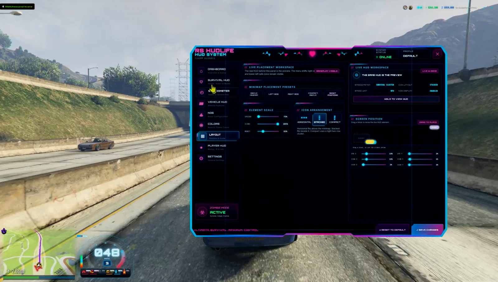
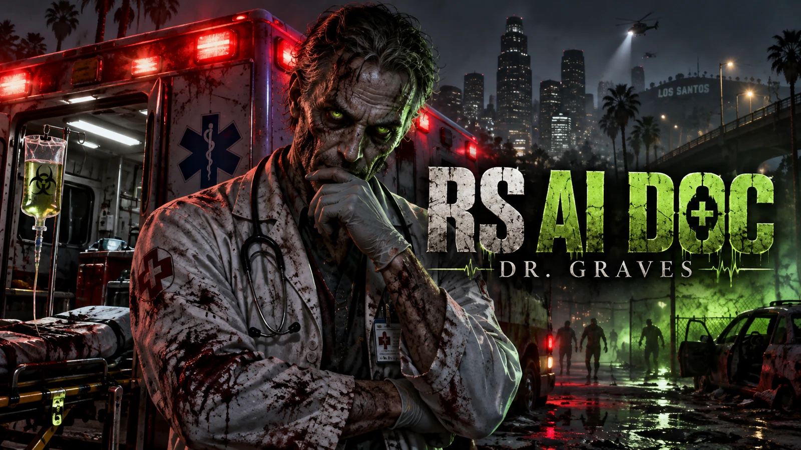
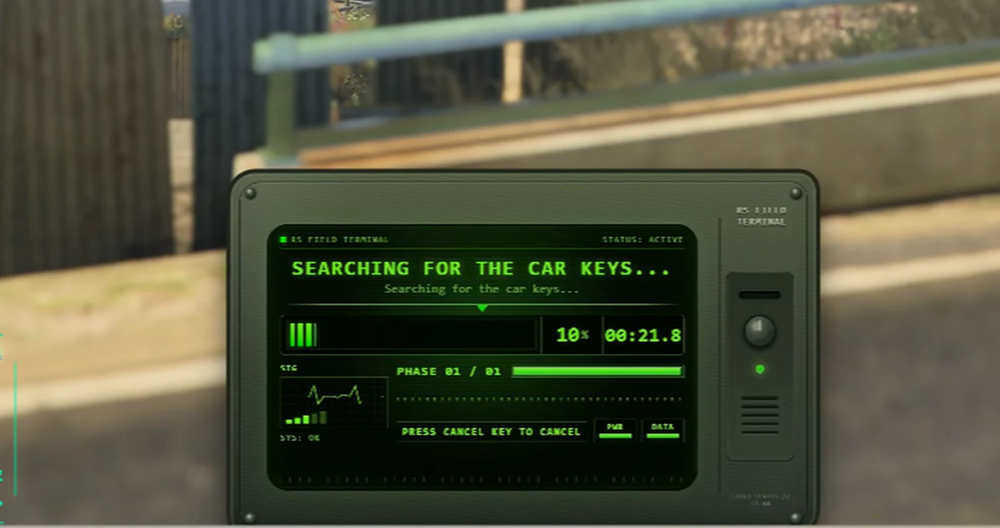
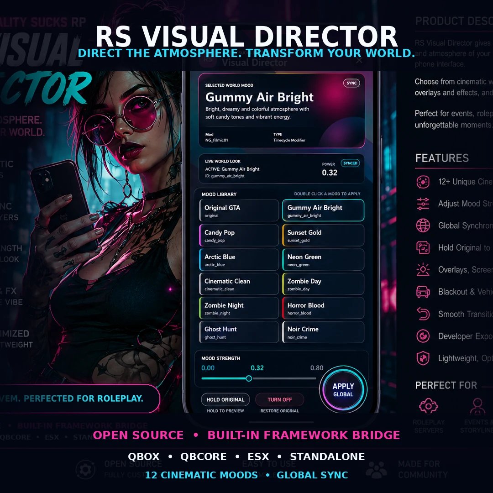
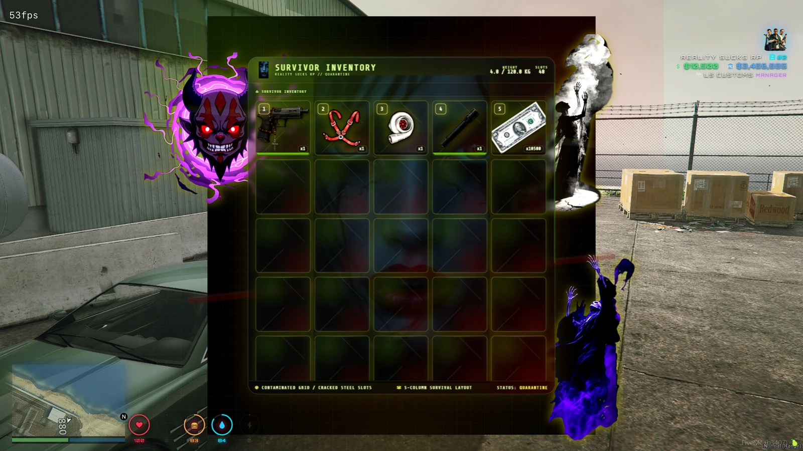
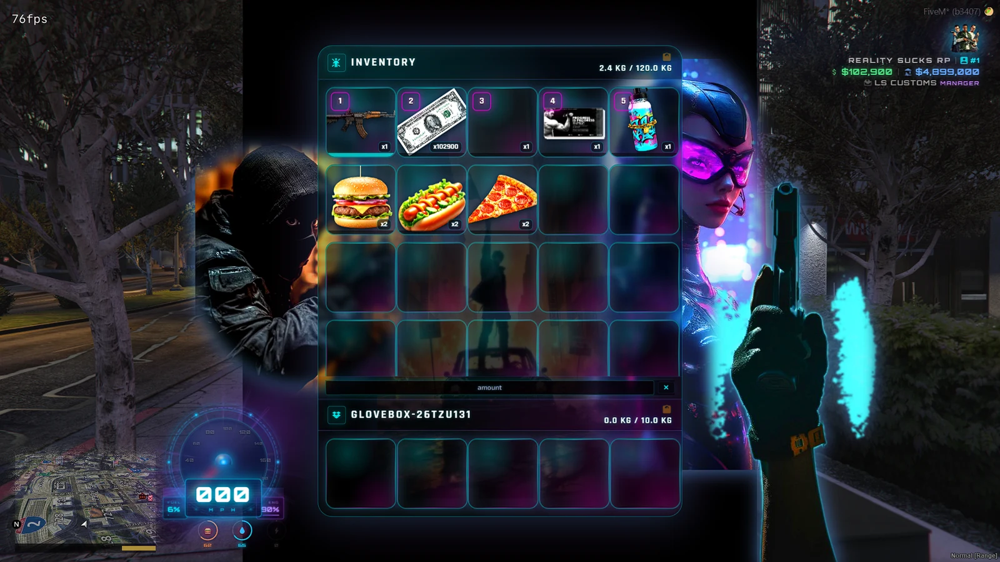
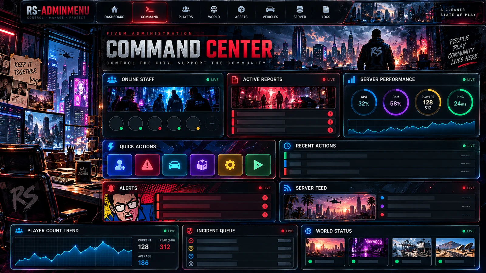
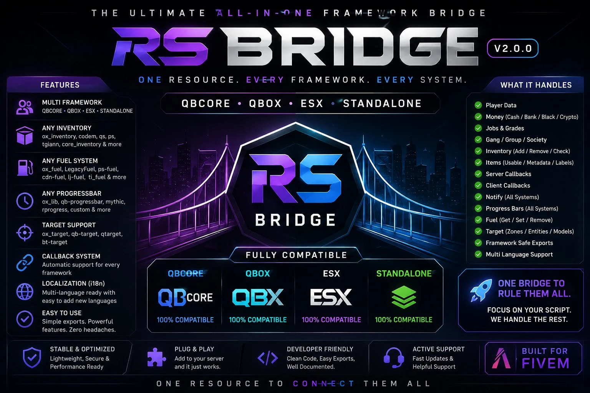
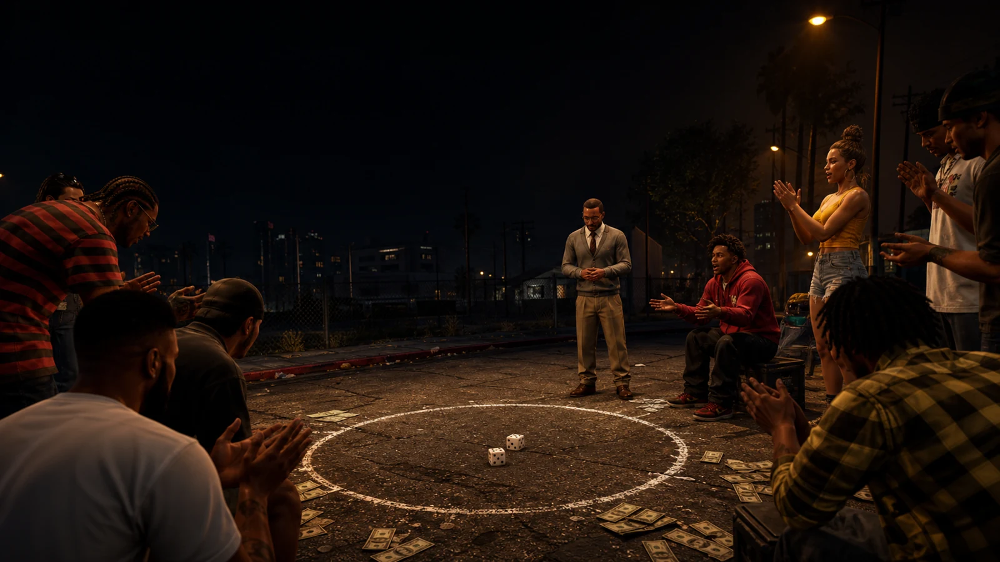
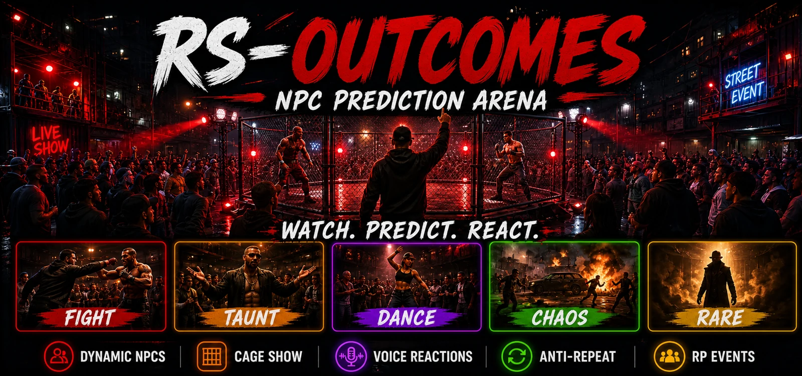

# RealitySucksRP

### FiveM scripts, complete server builds and custom gameplay systems

  
  
  
  

I love making FiveM scripts and running wild in GTA, but I also enjoy building complete servers. I build my own systems, test them in my own server builds and configure complete setups around what the server owner actually wants.

**Shops • Weapons • Phones • Racing • LS Customs • Garages • Dealerships • Zombie Apocalypse • Warfare • Phantom / Ghost Encounters • Inventories • UI • Framework Tools**

## What I Build

### Zombie and Survival
ZombieCore, outbreak gameplay, zombie shops, survivor systems, apocalypse vehicles, communications, garages and survival-focused UI.

### Vehicles and Racing
Dealerships, garages, LS Customs, tuning, race systems, ghost replay, vehicle businesses and street-focused gameplay.

### Shops, Weapons and Economy
Weapon shops, black markets, banking, inventory systems, businesses and server-authoritative economy features.

### Phantom, Horror and Warfare
Phantom vehicles, stalkers, cinematic encounters, warfare events and unpredictable world threats.

### Phones, UI and Server Systems
Phones, HUDs, progress systems, custom NUI, framework bridges, Miami-style inventory work and compatibility layers.

## Complete Server Packages

I build complete FiveM server setups using tested RealitySucksRP systems and configure them around the owner's preferred gameplay, framework, economy, theme and direction.

| Package | Price | Support |
|---|---:|---|
| QBCore Shell | **$500** | 30 days Discord support |
| Zombie Server | **$700** | 30 days Discord support |
| Full RP Server | **$850** | 30 days Discord support |

**Discuss a server build:** https://discord.gg/e9V3rPHySx

## Shop RealitySucksRP

The Tebex store is the main home for current RealitySucksRP releases, package details and commercial resources.

**Tebex:** https://reality-sucks-rp-webstore.tebex.io/

**Enhanced:** https://reality-sucks-rp-webstore.tebex.io/category/enhanced

## Free Scripts and Community Releases

My 10 [Tebex Free Scripts](https://reality-sucks-rp-webstore.tebex.io/category/free-scripts) listings and RS Admin Menu are below. Browse [the website catalog](https://realitysucksrp.github.io/#open-source) for the full screenshot galleries. Source access, dependencies and licenses vary by resource; check its listing.

### RS 90s Beeper

Bring 90s pager culture to your server. Send numeric or text pages to players, jobs, departments and gangs, then let the callback become the RP. Persistent inboxes, pager identities, batteries, signal and integration exports keep the network connected.

[Get free on Tebex](https://reality-sucks-rp-webstore.tebex.io/package/7738385) · [GitHub source](https://github.com/RealitySucksRP/rs-90sbeeper) · [YouTube preview](https://youtu.be/GohA449FBdM?si=WSziL5N0f5f8qL8b)

### RS HUDLife — Animated HUD

Make getting into a vehicle part of the experience. HUDLife combines 921 vehicle artwork images, 10 speedometer styles, cinematic startup animations and custom sounds with player status, money and NOS displays. Players can personalize the HUD through saved F9 settings.

[Get free on Tebex](https://reality-sucks-rp-webstore.tebex.io/package/7738377) · [GitHub source](https://github.com/RealitySucksRP/rs-lilhudlife) · [YouTube preview](https://youtu.be/Qo-D0QyAktE?si=4PsVCghqGk1oWjxU)

### RS AI DOC — Zombie EMS Rescue

No EMS on duty? Dr. Graves answers the call. This voiced zombie medic drives an ambulance to injured players, examines them and performs CPR. Medical animations, emergency response and an undead personality bring a memorable rescue service to survival and city RP.

[Get free on Tebex](https://reality-sucks-rp-webstore.tebex.io/package/7737475) · [GitHub source](https://github.com/RealitySucksRP/rs-aidoc) · [YouTube preview](https://youtu.be/DhZvbTEIA8Y)

### RS Radio — Modern Walkie Talkie

Keep emergency services, gangs, businesses and civilian groups talking. RS Radio pairs an interactive handheld interface with native Enhanced voice or Legacy pma-voice, restricted channels, live unit rosters and GPS emergency alerts. Persistent profiles, rechargeable batteries and RF jammers add more ways to build communication RP.

[Try live preview](https://realitysucksrp.github.io/rs-radio/) · [Get free on Tebex](https://reality-sucks-rp-webstore.tebex.io/package/7706219) · [GitHub source](https://github.com/RealitySucksRP/rs-radio) · [YouTube preview](https://www.youtube.com/watch?v=KuSvMqt7jnw)

### RSGTA Modern Progressbar

Give everyday actions a modern field-terminal display. This framework-independent progress provider supports single and multi-stage actions, animations, scenarios, attached props and cancellation. Use its QBCore, Qbox, ESX or direct-export paths to fit your existing resources.

[Get free on Tebex](https://reality-sucks-rp-webstore.tebex.io/package/7667590) · [GitHub source](https://github.com/RealitySucksRP/rsgta-progressbar) · [YouTube preview](https://www.youtube.com/watch?v=fnyxDDbBaKQ)

### ox_inventory — Miami Edition

Give ox_inventory a Miami identity with custom character artwork, atmospheric backgrounds and larger readable slots. Detailed item metadata, weapon attachment inspection, durability and cleaner secondary containers sit on the ox_inventory foundation, with modern Qbox setups in mind.

[Get free on Tebex](https://reality-sucks-rp-webstore.tebex.io/package/7657131) · [GitHub source](https://github.com/RealitySucksRP/ox_inventory-Reworked-Miami-Edition)

### RS Visual Director

Direct the atmosphere from a movable phone or widescreen Director Studio. Choose from 12 moods, preview a look locally, capture real gameplay galleries and save private Live Moments with their look and intensity. Apply a look globally when the scene is ready.

Supplied v2.9.0 test ZIP: Config.RequireAce = false lets every player change the global look. Enable ACE checks before public-server use.

[Get free on Tebex](https://reality-sucks-rp-webstore.tebex.io/package/7556700) · [GitHub source](https://github.com/RealitySucksRP/rs-visualdirector) · [Download v2.9.0 ZIP](https://github.com/RealitySucksRP/rs-visualdirector/releases/latest/download/rs-visualdirector.zip)

### RS Zombie Inventory

Build your inventory around the apocalypse. This QBCore edition brings zombie artwork and survival presentation together with physical cash, ground loot, weapon attachments, vehicle storage and item transfers. Customize the menu to match your survivor world.

[Get free on Tebex](https://reality-sucks-rp-webstore.tebex.io/package/7506318) · [GitHub source](https://github.com/RealitySucksRP/qb-inventory-Zombie-Menu-UI) · [YouTube preview](https://youtu.be/HrOj98U_89w?si=DWQiC69TE38P6d6D)

### RS Punk Inventory

Put your server identity inside the inventory. Neon artwork and custom branding pair with physical cash, HUD synchronization, weapons, floor drops, vehicle storage and player transfers. Server-authoritative updates and drop reconciliation help keep the menu connected to actual inventory state.

[Get free on Tebex](https://reality-sucks-rp-webstore.tebex.io/package/7449247) · [GitHub source](https://github.com/RealitySucksRP/qb-inventory-reworked-images-in-menu)

### RS Tuner Chip — Drift Controller

Install a tuner chip, pick a profile and send it sideways. Eight drift profiles apply controlled adjustments to each vehicle’s stock handling, with a dedicated controller and an option to restore the original setup. Vehicle-bound installation and mechanic exports connect the chip to your RP.

[Get free on Tebex](https://reality-sucks-rp-webstore.tebex.io/package/7391814) · [GitHub source](https://github.com/RealitySucksRP/RealitySucks-TunerChip) · [YouTube preview](https://youtu.be/2VgFQiGvuLA?si=WnuSrLr1up_bH3ds)

### RS Admin Menu

Run your staff tools from one FiveM command center. Manage players, reports, moderation, staff groups, vehicles and world controls. Customize the interface with themes and widgets, and use optional Pathways for onboarding and role certification. Included provider adapters connect the menu with your server.

Bundled interface concept artwork is shown above. Preserve live `data/` when upgrading; the full ZIP includes empty first-install stores.

[GitHub source](https://github.com/RealitySucksRP/rs-adminmenu) · [Download original ZIP](https://github.com/RealitySucksRP/rs-adminmenu/releases/latest/download/rs-adminmenu.zip)

### More Free Community Projects

- [RS Bridge](https://github.com/RealitySucksRP/rs_bridge) — Universal framework and provider compatibility layer for supported FiveM resources. [Tebex](https://reality-sucks-rp-webstore.tebex.io/package/7628375)

- [RS StreetDice](https://github.com/RealitySucksRP/rs-streetdice-street-craps) — Street-craps RP with a Bank NPC, visible dice, crowd reactions and server-authoritative rounds. Fictional in-game currency only.

- [RS Outcomes](https://github.com/RealitySucksRP/rs-outcomebets) — NPC prediction arena for community events, with live performers, reactions and crowd moments. RP entertainment only; follow the repository’s usage rules.
- [QB-Core Server.cfg Guide](https://github.com/RealitySucksRP/QB-Core-server.cfg) — A free starting point for new server owners: server branding, database configuration, resource load order and setup guidance.

- [RealitySucks Lightweight HUD](https://github.com/RealitySucksRP/RealitySucks-HUD) — The earlier QBCore player-information HUD, maintained separately from RS HUDLife.

GitHub is for source, documentation and community releases. **Tebex is the storefront.**

---

**Reality Sucks. Build something memorable anyway.**
